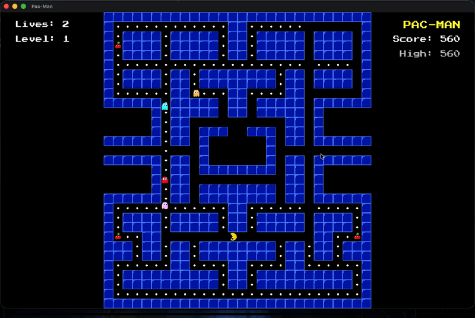

# Pac-Man (experiment)

A small C++ / SFML Pac-Man-style game built from scratch — maze, movement, ghosts, scoring, power-ups, and sound.



## Status

- [x] Windowed game loop with fitted maze view
- [x] Classic-style maze (walls, pellets, berries, tunnels)
- [x] Pac-Man movement, chomp animation, keyboard controls
- [x] Score, high score, lives, and level HUD
- [x] Four ghosts with chase / scatter / frightened / eaten AI
- [x] Collision (death / eat ghost when powered)
- [x] Berry power-up, flash warning, and level-scaled duration
- [x] Lives, game over, level clear, pause (Esc)
- [x] Sound effects (chomp, power, eat ghost, death, start)

## Requirements

- CMake 3.20+
- C++20 compiler
- [SFML 3](https://www.sfml-dev.org/) (`Graphics`, `Window`, `System`, `Audio`)

### macOS (Homebrew)

```bash
brew install sfml cmake
```

## Build & run

```bash
cmake -S . -B build
cmake --build build
./build/PacMan
```

Assets are copied into `build/` on every build.

## Controls

| Key | Action |
|-----|--------|
| Arrow keys | Move Pac-Man |
| Esc | Pause / resume (quit from game over) |
| Enter / Space | Restart after game over |
| Eat berry | Power up: faster, can eat ghosts |

## Layout

```
include/   headers
src/       game sources
assets/
  fonts/     Press Start 2P
  sounds/    chomp, power, eat_ghost, death, start
  sprites/   maze, Pac-Man, ghost
```

## License

Personal experiment — do what you want with it.
